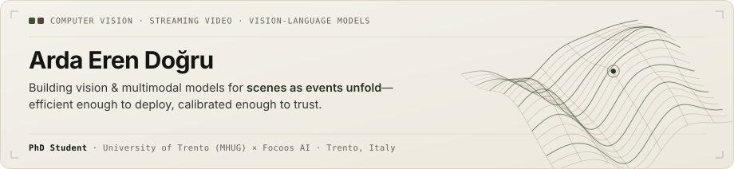

<picture>
  <source media="(prefers-color-scheme: dark)" srcset="./assets/header-dark.svg">
  <source media="(prefers-color-scheme: light)" srcset="./assets/header-light.svg">
  
</picture>

  <a href="https://scholar.google.com/citations?user=6P5XEP0AAAAJ&hl=en"><strong>Google Scholar</strong></a> &nbsp;·&nbsp;
  <a href="https://ardaerendogru.github.io/SAGE"><strong>SAGE (IEEE RA-L · ICRA ’27)</strong></a> &nbsp;·&nbsp;
  <a href="https://www.linkedin.com/in/ardaerendogru/"><strong>LinkedIn</strong></a> &nbsp;·&nbsp;
  <a href="https://mhug.disi.unitn.it/"><strong>MHUG · UniTN</strong></a> &nbsp;·&nbsp;
  <a href="https://focoos.ai/"><strong>Focoos AI</strong></a>

I am beginning my PhD in Information Engineering and Computer Science at the [University of Trento](https://www.disi.unitn.it/) ([MHUG](https://mhug.disi.unitn.it/)), supervised by [Prof. Massimiliano Mancini](https://mancinimassimiliano.github.io/) and [Dr. Fabio Cermelli](https://fcermelli.github.io/), and co-funded by [Focoos AI](https://focoos.ai/). My research focuses on **streaming video understanding**, **calibrated vision-language models**, and **unified scene representations**—accumulating visual evidence frame by frame as events unfold, separating real state changes from everyday clutter, and deciding *when* it is worth speaking up under realistic compute budgets.

Before moving to Trento, I studied Electronics and Communication Engineering at [Istanbul Technical University](https://www.itu.edu.tr/en), then completed my B.Sc. in Computer Engineering and M.Sc. in Data Science and Engineering at [Politecnico di Torino](https://www.polito.it/).

---

### Selected Research

- **[SAGE — Joint Semantic and Geometric Scene Understanding](https://ardaerendogru.github.io/SAGE)**  
  *Arda Eren Doğru et al.* · **IEEE Robotics and Automation Letters (RA-L)**, 2026 *(Accepted · Presenting at IEEE ICRA 2027, Seoul)*  
  Unified scene representation learning coupling semantic segmentation with dense 3D geometric structure for robotics and embodied perception without duplicated encoder overhead.

- **Encoder-Only Multi-Task Learning**  
  *M.Sc. Thesis, Politecnico di Torino*, 2025 · Advised by Prof. Carlo Masone & Dr. Fabio Cermelli  
  Investigated how far a single shared visual encoder can carry simultaneous dense prediction tasks without heavy task-specific decoders—analyzing representation sharing, task interference, and compute trade-offs.

### Open-Source & Utilities

- **[`dinov2_distillation`](https://github.com/ardaerendogru/dinov2_distillation)** · `PyTorch` · `Knowledge Distillation`  
  Distilling dense, task-agnostic visual representations from DINOv2 Vision Transformers into compact convolutional backbones for tight latency and memory budgets.

- **[`dl2curl`](https://github.com/ardaerendogru/dl2curl)** · `Browser Extension` · `Local CLI`  
  Intercepts authenticated browser downloads and translates them into ready-to-paste `curl`, `wget`, or `aria2c` commands with headers, cookies, and redirects intact—100% locally for headless GPU servers.
